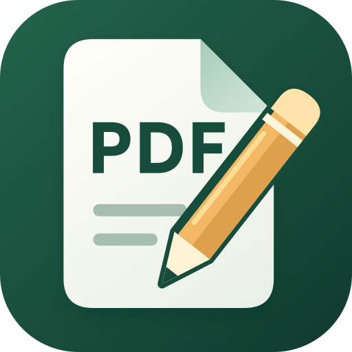

<p align="center">
  
</p>

<h1 align="center">阅读</h1>

<p align="center">
  一款本地优先的 Android PDF 阅读、对象级编辑与电子书阅读应用
</p>

<p align="center">
  <a href="https://github.com/lonnnnnng/reader/releases/latest"></a>
  
  
  <a href="LICENSE"></a>
</p>

<p align="center">
  <a href="https://github.com/lonnnnnng/reader/releases/latest"><strong>下载最新版</strong></a>
  ·
  <a href="#功能全景">功能全景</a>
  ·
  <a href="docs/pdf-editor-feature-summary.md">完整功能清单</a>
</p>

---

## 关于“阅读”

“阅读”不只是 PDF 查看器。它把日常阅读、内容对象编辑、页面整理、批注签名和电子书阅读整合在同一个 Android 应用中，并尽可能让文档处理留在设备本地。

应用首页提供三个清晰入口：

| 模式 | 适用场景 | 主要能力 |
| --- | --- | --- |
| **阅读 PDF** | 浏览、检索和长时间阅读 | 连续滚动、目录、缩略图、书签、全文搜索、文本复制、全屏阅读 |
| **编辑 PDF** | 修改内容和整理文档 | 编辑现有文字、路径与图片，插入内容，管理页面、批注、表单、签名和安全设置 |
| **电子书** | 阅读本地或在线书籍 | 支持 EPUB、TXT，本地文件与 HTTPS 直链，目录搜索、正文搜索、书签、音量键翻阅和阅读进度恢复 |

## 核心亮点

### 编辑真正的 PDF 内容对象

应用会解析 PDF 页面内容流中的文本、矢量路径、图片和 Form XObject。你可以直接选择并修改已有对象，而不是只在页面上叠加一层看似可编辑的内容。

- 修改文字内容、字号、字体、字距、行距和多行文本；
- 移动、缩放、旋转对象，调整颜色、透明度、线宽和混合模式；
- 替换或裁剪图片，插入文本、图片、矩形和直线；
- 多选、复制、粘贴、删除、锁定、对齐、等间距和图层排序；
- 智能吸附页面中心、页面边缘与其他对象边缘；
- 完整撤销与重做，并对不安全的复杂结构主动拒绝写入。

### 从阅读到文档处理

除了对象编辑，“阅读”还覆盖了常用的 PDF 文档工作流：页面导入、导出、拆分、合并、裁剪、旋转、尺寸调整、OCR、压缩、水印、页码、附件、目录、链接、元数据和权限管理。

### 更适合长时间小说阅读

电子书模式面向 EPUB 与 TXT 的连续阅读场景，既可以打开本地文件，也可以读取用户主动输入的 HTTPS 直链。

- 目录支持章节搜索，可按中文、英文或多个关键词同时筛选；搜索结果为空时会给出提示，清除条件后自动回到当前章节并保持高亮；
- 正文支持全文搜索、章节跳转、进度拖动、书签添加与管理，重新打开应用后可恢复最近阅读位置；
- 字号、行距、页边距和阅读主题可单独调整，设置会持久化保存，并自动修复异常或损坏的历史值；
- 可选择在阅读正文时保持屏幕常亮，离开 TXT/EPUB 正文后立即恢复系统休眠策略；
- 可选择使用音量上键向前、音量下键向后翻阅；打开目录、搜索、书签或设置面板时，音量键仍交还系统调节媒体音量。

### 安全保存与故障恢复

保存不是简单地覆盖原文件。应用会先写入临时文件，重新解析并检查关键结构；覆盖前还会核对来源文件指纹，并在失败时尝试从备份恢复。未保存的编辑会写入恢复文件，应用重新打开后可以继续处理。

## 功能全景

| 模块 | 当前能力 |
| --- | --- |
| **PDF 阅读** | 连续纵向阅读、页面预取、页面跳转、缩略图、目录、书签、按 PDF 指纹持久化的全文索引、同页多命中与高亮、上一处/下一处循环导航、文本复制、阅读历史、断点恢复、页内/网页链接、附件入口 |
| **显示与交互** | 全屏模式、适合宽度、适合高度、平移、捏合缩放、高清区域渲染、横竖屏自适应检查器 |
| **内容对象编辑** | 文本、路径、图片、Form XObject 的选择与编辑；位置、尺寸、旋转、颜色、透明度、描边和混合模式调整 |
| **内容插入** | 插入文本、图片、矩形和直线；设备字体导入、内置字体回退、图片替换与裁剪 |
| **批量编辑** | 多选、复制、粘贴、删除、锁定、撤销、重做、对齐、等间距、智能吸附和安全范围内的图层排序 |
| **页面管理** | 插入空白页、复制、删除、移动、批量旋转、裁剪、调整尺寸、从其他 PDF 导入、保留结构导出、展平副本导出、拆分与多 PDF 合并 |
| **批注与表单** | 高亮、下划线、删除线、便签、FreeText、图章、手写签名、批注属性编辑，以及表单字段创建、填写与删除 |
| **遮盖与签名** | 永久遮盖、OCR 文字层安全处理、PKCS#12/PFX 可见或不可见数字签名、签名状态与证书链检查 |
| **文档结构** | 元数据、目录、链接和附件的新增、修改、移动、导出或删除 |
| **文档处理** | OCR 可搜索文字层、图片重编码压缩、水印、页码、AES-128/AES-256 加密与细粒度权限设置 |
| **系统集成** | Android 文件选择器、系统打开方式、系统分享、系统打印、GitHub Release 在线更新 |
| **电子书** | 本地与 HTTPS 在线 EPUB/TXT、目录与章节搜索、正文搜索、书签、阅读历史、进度恢复、屏幕常亮和音量键翻阅 |
| **个性化** | 浅色、深色、跟随系统三种主题，Material You 动态色与强调色设置 |

更细的功能范围与限制见 [PDF 编辑器功能汇总](docs/pdf-editor-feature-summary.md)。

## 数据与隐私

- PDF 的读取、编辑、OCR 和导出均在设备本地完成，不上传到服务端；
- 应用无需账号，不集成用户行为遥测；
- 文件通过 Android Storage Access Framework 选择，应用只访问你明确授权的文档；
- 网络用于打开用户主动输入的在线电子书地址，以及主动检查和下载 GitHub Release 更新；
- 已有数字签名或无法确认签名状态的 PDF 禁止覆盖保存，避免无提示破坏签名；
- 全页“保留结构”导出直接写入当前文档；部分页面遇到 Tagged PDF、可选内容组、脚本动作、复杂名称树和跨 Form 等高风险结构时，会提示改用静态展平副本。

## 下载与安装

前往 [GitHub Releases](https://github.com/lonnnnnng/reader/releases/latest) 下载最新签名 APK。

| 项目 | 要求 |
| --- | --- |
| 系统版本 | Android 8.0（API 26）及以上 |
| 应用包名 | `com.loooong.reader` |
| 发布渠道 | GitHub Releases |

首次安装时，Android 可能要求你允许当前文件管理器或浏览器“安装未知应用”。升级时可直接安装新版本；如果设备上存在使用其他签名的历史构建，需要先卸载旧版本。

## 从源码构建

### 环境要求

- JDK 17；
- Android SDK 35；
- Android Studio 或可用的 Gradle/Android 命令行环境。

### 构建步骤

```bash
git clone https://github.com/lonnnnnng/reader.git
cd reader
./gradlew :app:assembleDebug
```

Debug APK 输出位置：

```text
app/build/outputs/apk/debug/app-debug.apk
```

运行单元测试和静态检查：

```bash
./gradlew :app:testDebugUnitTest :app:lintDebug
```

正式版构建需要配置你自己的 Android 签名信息；仓库不会包含发布密钥或密码。

## 技术栈

| 领域 | 技术 |
| --- | --- |
| 界面 | Kotlin、Jetpack Compose、Material 3 |
| PDF 解析与写入 | PDFBox Android、自研内容流解析与编辑层 |
| EPUB 阅读 | Readium Kotlin Toolkit |
| OCR | Google ML Kit 中文文字识别 |
| 文件访问 | Android Storage Access Framework、FileProvider |
| 状态与恢复 | ViewModel、文档指纹、临时文件校验与恢复快照 |

## 项目结构

```text
app/src/main/java/com/loooong/reader/
├── engine/          PDF 内容流、页面和文档级编辑引擎
├── ui/              Compose 阅读、编辑和工具界面
├── MainActivity.kt  首页入口、文档打开和应用导航
├── PdfDocumentViewModel.kt
│                    PDF 会话、编辑状态、保存与恢复协调
└── EbookViewModel.kt
                     EPUB/TXT 打开、在线下载与阅读状态
```

## 当前边界

- 合并多个 PDF 时以页面内容与资源为主，不会自动合并所有源文档的目录、表单、附件和文档级动作；
- 暂未提供 TSA、OCSP、CRL、PAdES-LTV、XFDF 批注交换、PDF/A/UA 合规检查和文档比较；
- PDF 全文索引会按源文件内容指纹持久化并跨应用重启复用；加密 PDF 和存在未保存编辑的文档不会持久化文本，命中坐标会在用户跳到对应页面时按需加载；
- PDF 内容流结构差异很大，遇到无法确认安全性的操作时，应用会给出提示并停止写入。

## 参与贡献

欢迎通过 [Issues](https://github.com/lonnnnnng/reader/issues) 报告问题或提出建议。提交问题时，建议附上 Android 版本、应用版本、复现步骤；如果 PDF 可以公开，也可以提供用于复现的最小样本。

提交代码前请至少运行：

```bash
./gradlew :app:testDebugUnitTest :app:lintDebug :app:assembleDebug
```

## 开源协议与致谢

本项目基于 [PDF Inspector for Android](https://github.com/shardulvs/pdfinspector-android) 持续改造，并使用 [MIT License](LICENSE) 开源。感谢原项目作者以及 PDFBox、Readium、ML Kit 等开源项目的贡献者。
